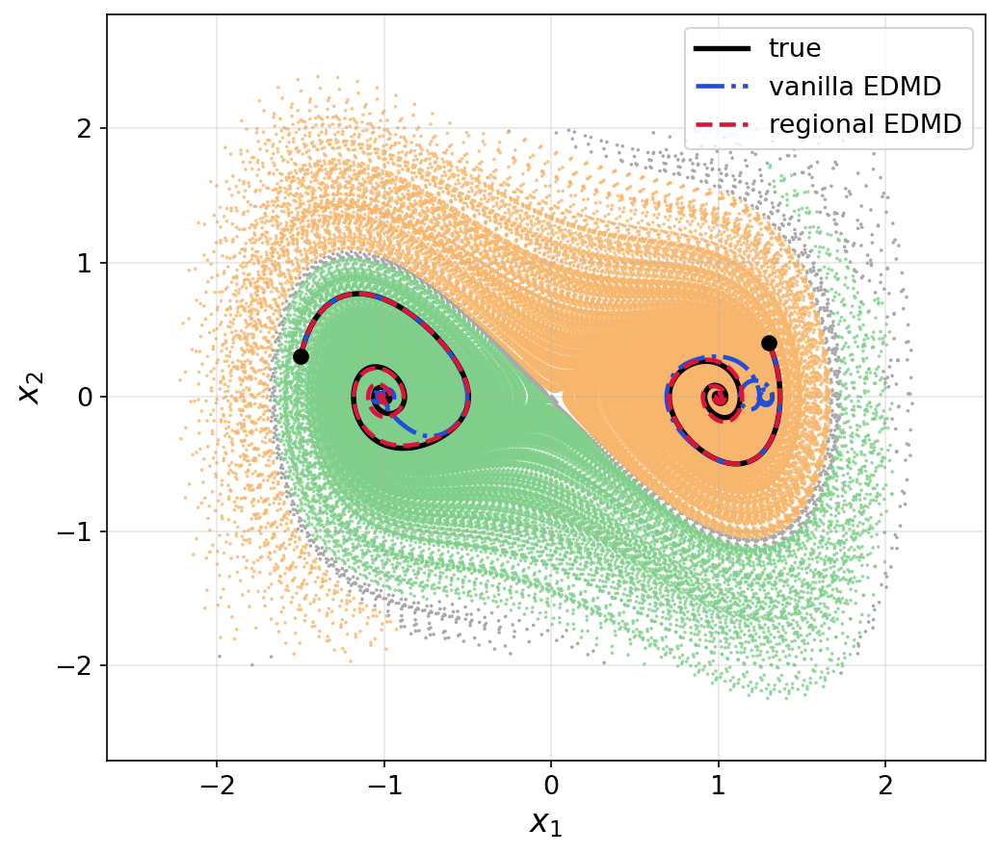
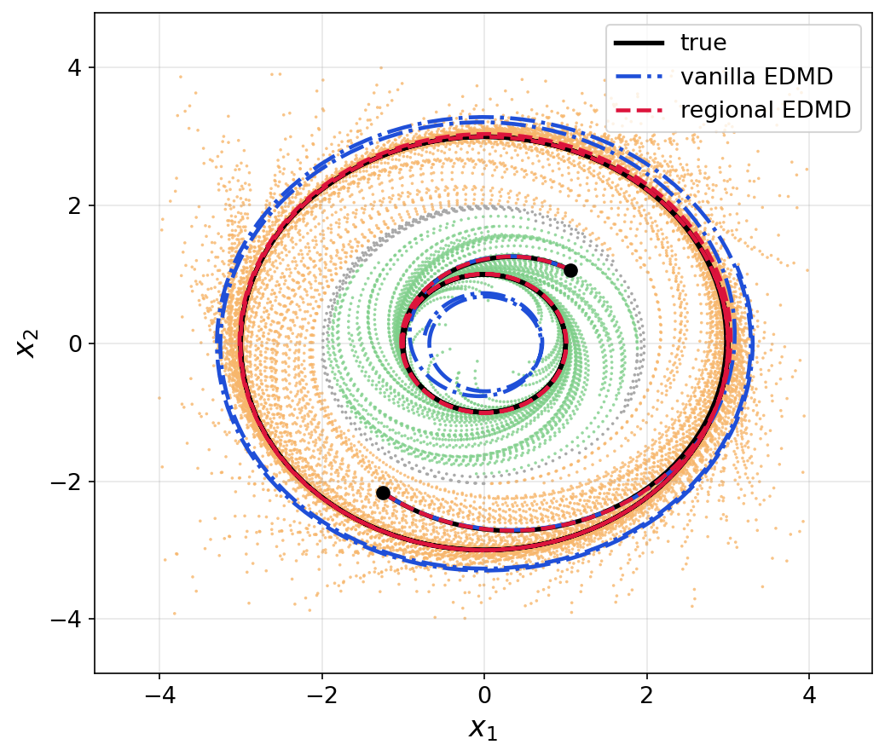

# Regional-EDMD

Code and experiments for the paper

> **Learning Omega-Limit Partitions from Approximate Koopman Invariants**

Given snapshot pairs `(x_t, x_{t+1})` of a nonlinear system with several attractors, the
method

1. solves a generalized eigenvalue problem over an EDMD dictionary for
   **approximate Koopman-invariant observables** (functions that are nearly constant along
   trajectories),
2. clusters the data in those coordinates into fine cells and merges them, first by empirical
   transition probabilities and then by value-space proximity, into an approximate
   **omega-limit partition** of the state space (Algorithm 1 in the paper), and
3. fits one **regional EDMD model per partition cell**. Because the learned cells are forward
   invariant, a trajectory never leaves its cell: the initial condition is classified once and
   that cell's regional model is used for the entire rollout, with no switching between models.
   Long-horizon prediction is compared against a single vanilla EDMD model fit on the same data.

Two examples from the paper are included: the **Duffing oscillator** (two stable equilibria)
and a planar system with **bistable oscillations** (two stable limit cycles), plus a 1-D
bistable toy used for sanity checks.

<p align="center">
  
  
</p>

## Contents

- [Repository layout](#repository-layout)
- [Installation](#installation)
- [Start here: the notebooks](#start-here-the-notebooks)
- [Running the pipeline from the command line](#running-the-pipeline-from-the-command-line)
- [Regenerating the paper figures and tables](#regenerating-the-paper-figures-and-tables)
- [Configuration reference](#configuration-reference)
- [Implementation notes](#implementation-notes)
- [Citation](#citation)

## Repository layout

```
src_omega_partition/    library: invariants, partition (Algorithm 1), regional EDMD models,
                        anchor-based labels, plotting, plus the vendored simulator
                        (dynamical_systems.py) and dictionary classes (basis_functions.py)
scripts/                one script per pipeline stage; each takes a single JSON config
configs/<system>/       JSON configs for duffing, bistable_oscillations and bistable (1-D toy)
data/<system>/          datasets (*.npz) with tracked *.meta.json provenance, pipeline outputs
data/paper_plots/       arrays cached by notebooks/paper_plots.ipynb
notebooks/              walkthrough notebooks (the main entry point, see below)
plotting/               paper-figure scripts + results table, driven by data/paper_plots/
figures/                figures written by the pipeline scripts (paper-styled ones in figures/paper/)
```

## Installation

Python ≥ 3.11 with numpy, scipy, scikit-learn, matplotlib (and pandas / jupyter for the
notebooks):

```bash
git clone <this repository>
cd Regional-EDMD
pip install -r requirements.txt
```

The datasets used in the paper are shipped in `data/<system>/` (`*_data.npz`,
`*_validation_data.npz`, `*_target_data*.npz`), so the simulator is only needed to regenerate
them or to draw "true" trajectories from custom initial conditions; every other stage runs
from the stored files.

## Start here: the notebooks

The notebooks are the primary record of the experiments. They use the `src_omega_partition`
library and the pipeline scripts' functions directly, read only the committed datasets, and
write nothing to `data/` (except `paper_plots.ipynb`, which caches its arrays in
`data/paper_plots/`). Run them from the repository root, e.g.
`jupyter lab notebooks/duffing_walkthrough.ipynb`.

| Notebook | What it does |
|---|---|
| [`duffing_walkthrough.ipynb`](notebooks/duffing_walkthrough.ipynb) | Step-by-step construction of the omega-limit partition for the Duffing oscillator. Section by section it introduces one ingredient of Algorithm 1, sweeps its parameter on a grid, plots the effect, and then fixes the paper value: dictionary and approximate invariants (`gamma`, `epsilon`), scalar clustering into fine cells (`scalar_cluster_count`), occupancy filter (`tau_occ`), transition-based merging (`tau_tr`), value-based merging (`tau_val`), the final partition, validation against labeled trajectories and the robustness margin (`tau_robust`). The last two sections fit the regional EDMD models and the vanilla EDMD baseline on the final partition, and sweep the EDMD dictionary (number of RBF centers, `gamma`, polynomial degree) on one initial condition per attractor. |
| [`bistable_oscillations_walkthrough.ipynb`](notebooks/bistable_oscillations_walkthrough.ipynb) | The same walkthrough for the bistable-oscillations system, including the case where the occupancy filter is essential. |
| [`paper_plots.ipynb`](notebooks/paper_plots.ipynb) | Produces every figure and number in the paper end to end for both systems, with the parameters in `configs/<system>/`: partition, validation phase portrait (correct / misclassified / dropped points), two-initial-condition rollouts (time series and phase plane) and gated rollout-error curves, regional vs vanilla EDMD. Caches all arrays in `data/paper_plots/<system>/*.npz` for the `plotting/` scripts. |


## Running the pipeline from the command line

Each stage is a script in `scripts/` that takes one JSON config from `configs/<system>/`.
Replace `<system>` with `duffing` or `bistable_oscillations` (paper examples) or `bistable`
(1-D toy). Because the datasets are shipped, you can start at step 3.

```bash
# 1. training snapshots + k-means RBF center pool        -> data/<system>/<system>_data.npz
python scripts/generate_data.py            configs/<system>/generate_data.json
# 2. labeled validation trajectories                     -> data/<system>/<system>_validation_data.npz
python scripts/generate_validation_data.py configs/<system>/generate_validation_data.json

# 3. approximate omega-limit partition (Algorithm 1)     -> data/<system>/partition_output.npz
python scripts/build_partition.py          configs/<system>/build_partition.json
# 4. partition accuracy against anchor states (equilibria or reference limit cycles)
python scripts/validate_partition.py       configs/<system>/validate_partition.json
# 5. regional EDMD model per cell + vanilla EDMD baseline; one-step and rollout metrics;
#    figures partition_scatter / phase_trajectories / phase_portrait / rollout_errors
#    -> data/<system>/{regional_models,vanilla_edmd_model}.npz, figures/<system>/
python scripts/build_multiple_linear_models.py configs/<system>/build_multiple_linear_models.json

# 6. paper-styled versions of the step-5 figures        -> figures/paper/<system>/
python scripts/generate_plots.py           # both paper systems; or pass one config / plot-data .npz
python scripts/generate_merge_diagram.py   # Fig. 1 schematic   -> figures/paper/algorithm/
```

Step 5 prints the numbers reported in Table I of the paper (classification accuracy and mean
relative rollout error at selected time steps) for both the regional and the vanilla model.
For `bistable_oscillations`, step 2 needs the two reference limit cycles used as class anchors;
generate them before the validation data with

```bash
python scripts/generate_data.py configs/bistable_oscillations/generate_target_data1.json
python scripts/generate_data.py configs/bistable_oscillations/generate_target_data2.json
```

With no argument, `generate_plots.py` redraws the two paper systems; for the 1-D toy run
`python scripts/generate_plots.py data/bistable/multiple_linear_models_plot_data.npz`.

## Regenerating the paper figures and tables

Two routes produce paper figures:

- **Notebook route (used for the paper).** Run `notebooks/paper_plots.ipynb`, then

  ```bash
  python plotting/plot_all.py                 # all figures for both systems -> plotting/
  python plotting/plot_all.py duffing --show  # one system, interactive
  python plotting/make_results_table.py       # -> plotting/results_table.md
  ```

  Each `plotting/plot_*.py` reads one cached `data/paper_plots/<system>/<name>.npz`, so
  figure styling can be changed without re-running the notebook.

- **Script route.** `scripts/build_multiple_linear_models.py` saves its plot arrays to
  `data/<system>/multiple_linear_models_plot_data.npz`; `scripts/generate_plots.py` redraws
  them into `figures/paper/<system>/`.

## Configuration reference

Every config carries an `"explanation"` block documenting each key (ignored by the scripts).
Paths inside configs are relative to the repository root. The parameters of Algorithm 1 live
in `build_partition.json`:

| Key | Role |
|---|---|
| `gamma`, `d_poly` | Dictionary for the invariants: Gaussian RBF precision (`exp(-gamma‖x−c‖²)`) on the k-means center pool, plus polynomials up to degree `d_poly` (`-1` = RBF only). |
| `epsilon`, `reg`, `max_invariant_modes` | Keep generalized eigenvectors with eigenvalue below `epsilon` (at most `max_invariant_modes`); `reg` is Tikhonov regularization of the Gram matrix. |
| `scalar_cluster_count` | k-means clusters per invariant coordinate (int or list). The first mode is the constant function whenever the dictionary contains it, so its entry must be `1`. |
| `tau_occ` | Minimum empirical weight of a fine cell; smaller cells are dropped. |
| `tau_tr` | Merge two cells when the empirical transition probability between them exceeds `tau_tr`. |
| `tau_val` | Merge two cells when their centroids in invariant space are closer than `tau_val`. |
| `tau_robust` | Post-merge margin: points within `tau_robust` (relative to the merged region length, per coordinate) of a label-changing boundary are left unlabeled. Stored with the partition and applied at inference. |

The EDMD dictionary for the regional models is set separately in
`build_multiple_linear_models.json` (`edmd_gamma`, `edmd_d_poly`, `number_centers_edmd`;
`0` centers gives a polynomial-only dictionary). The paper values (`1.0`, `6`, `100`) are the
best of the sweeps in the walkthrough notebooks. `compare_vanilla_edmd` toggles the baseline
(by default with the same dictionary; `vanilla_*` keys override it), `ICs_phase_plot` fixes
the initial conditions of the phase plots, and `run_gated_evaluation = false` skips the slow
validation-set evaluation while tuning. There is no option to reclassify along a rollout: the
cells are forward invariant, so only the initial condition is classified.

## Implementation notes

- **Rollouts** lift the initial state once and propagate linearly in the lifted space
  (`z_{t+1} = z_t K`, decoded as `x_t = z_t R` for storage only). Re-lifting the decoded state
  every step would turn the model into a chained one-step predictor with far smaller errors;
  both the regional models and the vanilla baseline use the lift-once rollout.
- **One classification per trajectory.** The learned cells are forward invariant (unions of
  basins of attraction), so a trajectory stays in the cell of its initial condition. The
  initial state is classified once, and that cell's regional model propagates the whole
  horizon; the rollout never switches models. If the initial state is unlabeled (dropped by
  `tau_occ` or `tau_robust`) or its cell has no fitted model, no regional prediction is made.
- **Regional vs vanilla fits.** The vanilla model is fitted on all snapshot pairs; each regional
  model only on the pairs its cell keeps (occupancy- and `tau_robust`-dropped pairs excluded).
  Both paper configs fit the regional models on the validation set; the partition itself is fit
  on the training set.
- **Class labels** for validation come from anchors: the equilibrium (`target_equilibria`)
  or reference trajectory (`target_data_paths`) closest to a trajectory's final state.
- **`bistable_oscillations`** is simulated in `src_omega_partition/dynamical_systems.py`
  by the closed-form flow map of `r' = (r−2) − (r−2)³, θ' = 1` with `dt = 0.05`, which
  reproduces the stored datasets to ~1e-7 (an Euler step would drift by ~0.7).
- **RBF convention** is `exp(-gamma ‖x − c‖²)` (gamma is a precision); larger `gamma` means
  narrower bumps.
- The 1-D `bistable` toy has several numerically degenerate invariant modes; its intermediate
  fine-cell counts vary with floating-point noise, the final partition (2 cells, ~99.8%) does
  not.

## Citation

If you use this code, please cite the paper:

```bibtex
@inproceedings{shah2027omegalimit,
  title     = {Learning Omega-Limit Partitions from Approximate Koopman Invariants},
  author    = {Shah, Dhruv and TODO},
  booktitle = {TODO},
  year      = {2027}
}
```

## License

Released under the [MIT License](LICENSE).
